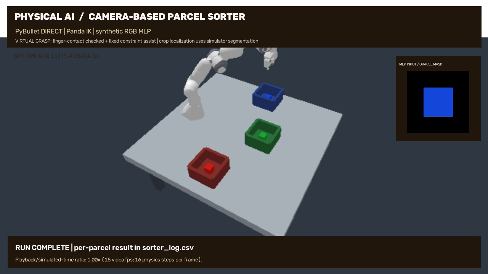

# 画像認識AIによる荷物仕分けロボット

Physical AI応用編1 最終課題｜PyBulletシミュレーション

## できたこと

赤・緑・青の小箱をカメラ画像から識別し、対応色のトレイへ仕分けるアームロボットを制作した。最終実行では**1試行・3個すべてで仕分けに成功**し、別途レンダリングした評価画像は**45/45枚正解**だった。いずれも限定されたシミュレーション内の結果であり、実機の性能や一般物体への認識性能を示すものではない。

## 目的と仕組み

色ごとの小物仕分けを題材に、画像認識の出力がロボットの行き先を変える、小さく再現可能なAIと制御の連携を実装した。GPUや外部APIキーを必要とせず、CPU上で学習・推論・物理シミュレーション・動画収録まで実行できる。

認識には、PyBulletの俯瞰カメラで実際に描画した180枚の小箱画像を使用した。135枚で学習し、残り45枚は学習に使わず評価した。背景を除いたRGB画素の平均・標準偏差・四分位点など15特徴を標準化し、隠れ層16・8ユニットの多層パーセプトロン（MLP）で3色を分類する。位置、向き、色には小さな変動を加えたが、カメラや照明などは固定条件である。

実行時の**予測色が搬送先トレイの座標を選ぶ**。アームはFranka Pandaの既存モデルを使用し、逆運動学（IK）と関節位置制御で、接近・下降・把持・持上げ・搬送・解放・退避を順に行う。独自に実装したのは作業台、トレイ配置、画像収集、特徴抽出、分類器の学習・推論、制御の組合せ、実測判定と記録である。

## 実測結果

| 小箱の正解色 | AIの予測色・搬送先 | 把持時の指接触数 | 持上げ後の高さ | 仕分け |
|---|---|---:|---:|---|
| RED | RED | 2 | 0.977 m | 成功 |
| GREEN | GREEN | 2 | 0.977 m | 成功 |
| BLUE | BLUE | 2 | 0.977 m | 成功 |

画像評価の混同行列は、赤・緑・青それぞれ15枚正解、誤分類0枚だった。分類に成功しただけでは搬送成功とはしない。指の接触を確認し、物体が元の位置より0.12 m以上持ち上がり、正しい色のトレイへ到達することを確認した。解放後1.4秒の物理計算を経た中心位置が、トレイ中心からXY各±0.066 m以内、高さ0.64〜0.69 mにあることを成功条件にした。

追加テストでは、同じ物体IDのまま見た目の色だけを交換すると予測もその色に追従し、物体IDを色として使っていないことを確認した。また、指が接触していない3物体では把持補助の作成を拒否した。評価画像・特徴・JSON・CSVに加えて、これらのテスト結果もコード一式に保存した。

収録動画は**72.13秒、1280×720、15 fps、音声なし**。物理計算は240 Hz、16ステップごとに1フレームを収録し、ほぼ1倍速で再生する。ネイティブ描画は640×360で、説明文字を読みやすくするため拡大して収録した。動画生成AIによる映像ではない。

## 失敗から修正した点

初期版は画像評価42/45枚で、動作も赤だけが成功した。俯瞰カメラと背景を除いたRGB統計へ変更し、色認識を安定させた。さらに、手先の基準を手の原点から指間の把持中心へ直し、トレイとグリッパーが干渉しないよう配置の間隔を広げた。失敗した試行を成功へ書き換えず、開発履歴として残した。

## できていないこと・前提

対象画素の切り出しには、シミュレーターが返す正解マスク（oracle segmentation）を使用する。画像だけから物体を発見する検出器や3D位置推定は未実装で、把持位置もシミュレーターの既知座標を使う。

搬送中は、指の接触と距離を確認した場合に限り、固定拘束による**仮想把持補助**を使用する。純粋な摩擦による把持の成功を実証したものではない。未学習の色、一般物体、実画像、実機、未知の障害物への対応は未検証であり、これらが次の課題である。

## 再現と制作補助

Python 3.12環境で `requirements.txt` をインストールし、`OPENBLAS_NUM_THREADS=1 OMP_NUM_THREADS=1 python3 sorter.py --output reproduced` を実行する。記録済みの正式結果は `outputs/evaluation.json`、`outputs/run_summary.json`、`outputs/sorter_log.csv` と追加テストの `outputs/integrity_tests.json` を参照する。詳細はREADMEに記載した。

コード作成・ローカル実行・説明資料作成にはAIエージェントの補助を使用した。記載した数値は実際に保存された実行結果に基づく。利用者本人の実機操作や学習体験を記録したものではない。

## 使用した技術と出典

- [PyBullet公式Quickstart](https://github.com/bulletphysics/bullet3/blob/master/docs/pybullet_quickstart_guide/PyBulletQuickstartGuide.md.html)：物理計算、カメラ、逆運動学。
- [scikit-learn MLPClassifier](https://scikit-learn.org/stable/modules/generated/sklearn.neural_network.MLPClassifier.html)：多層パーセプトロン。
- [Panda URDF配布元](https://github.com/bulletphysics/bullet3/blob/master/examples/pybullet/gym/pybullet_data/franka_panda/panda.urdf)：既存ロボットモデル。Apache-2.0。メッシュ等は依存パッケージから読み込み、独自モデルとは主張しない。
